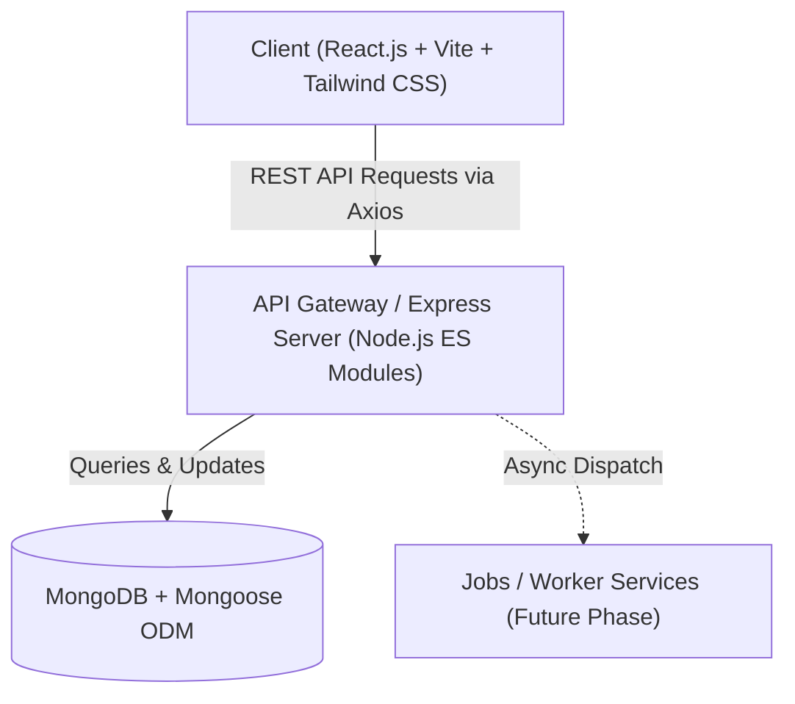
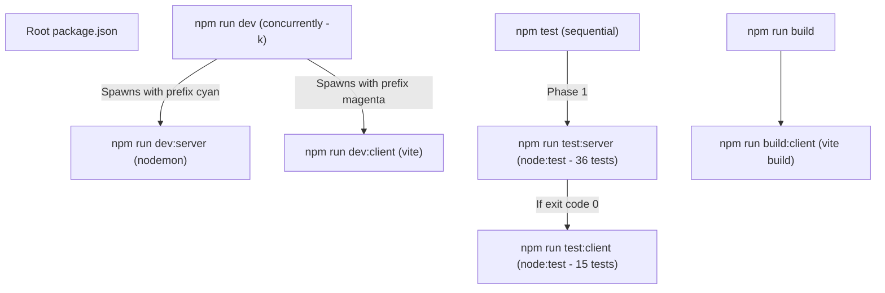
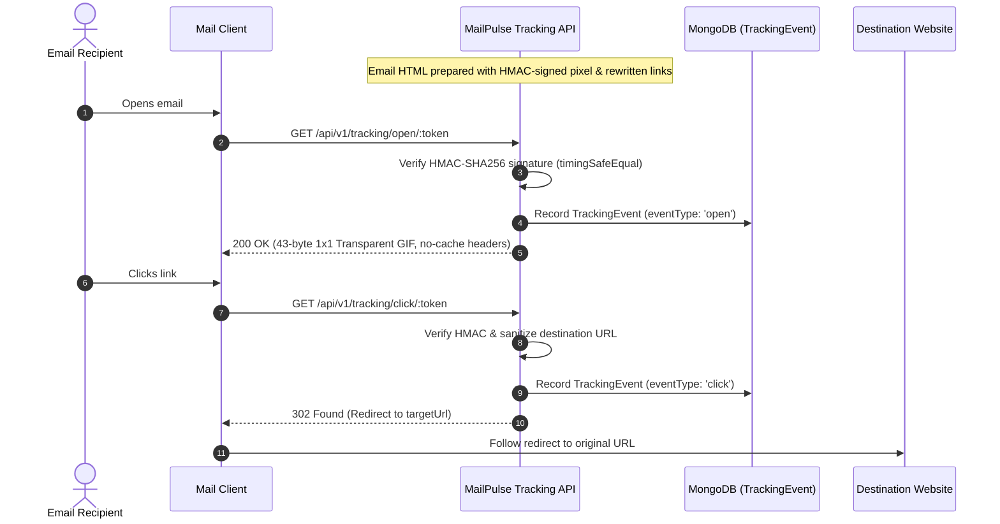
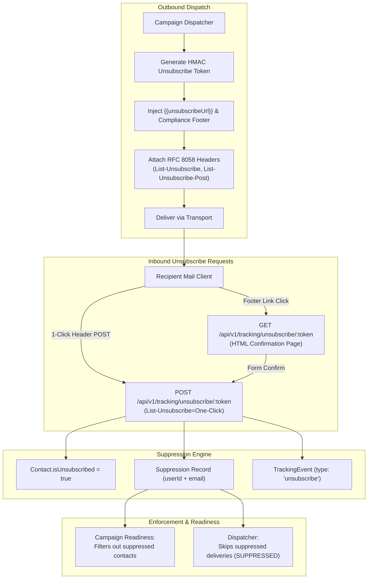
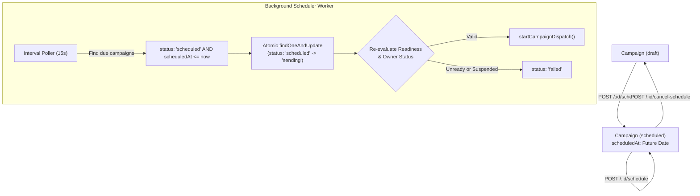

# MailPulse Architecture

## 1. System Overview

**MailPulse** is a modern, full-stack email campaign management and analytics platform built on the MERN stack (MongoDB, Express.js, React.js, Node.js). It provides creators, marketers, and developers with reliable contact management, automated campaign scheduling, real-time email delivery tracking, and performance analytics.



---

## 2. Technology Stack

### Frontend
- **Framework / Runtime**: React 19, Vite
- **Styling**: Tailwind CSS
- **Routing**: React Router (`react-router-dom`)
- **HTTP Client**: Axios
- **Data Visualization**: Recharts

### Backend
- **Runtime**: Node.js (ES Modules)
- **Framework**: Express.js
- **Database & ODM**: MongoDB, Mongoose
- **Security & Headers**: Helmet, CORS
- **Rate Limiting**: express-rate-limit
- **Validation**: Zod
- **Logging**: Morgan
- **Testing**: Node.js Native Test Runner (`node:test`)
- **Development**: Nodemon

---

## 3. Architecture Layers

MailPulse follows a modular, layered architecture to maintain clear separation of concerns:

```
MailPulse/
├── Presentation Layer (client/)
│   ├── Components (common, layout, contacts, campaigns)
│   ├── Pages (auth, dashboard, contacts, campaigns, analytics)
│   └── State & Services (context, hooks, services, utils)
│
├── API & Routing Layer (server/src/routes, middleware)
│   ├── Security Middleware (Helmet, CORS, Rate Limit)
│   ├── Request Validation (Zod schemas)
│   └── Error Handling (centralized error middleware)
│
├── Business Logic Layer (server/src/services, controllers, jobs)
│   ├── Controllers (Request orchestration)
│   ├── Services (Domain & business logic)
│   └── Background Jobs (Asynchronous tasks)
│
└── Data Layer (server/src/models, config/db.js)
    ├── Mongoose Schemas & Models
    └── MongoDB Connection Management
```

---

## 4. Directory Structure and Responsibilities

| Directory | Layer / Purpose | Phase |
| :--- | :--- | :--- |
| `client/src/components/common` | Reusable UI atoms and primitives (buttons, inputs, modals, badges) | Foundation / Ready |
| `client/src/components/layout` | Shell layout, navigation bar, sidebar, footer | Foundation / Ready |
| `client/src/components/contacts` | Contact lists, table views, tag managers | Future Phase |
| `client/src/components/campaigns` | Campaign creation wizards, template previewers | Future Phase |
| `client/src/pages/auth` | Login, registration, password recovery views | Future Phase |
| `client/src/pages/dashboard` | Main operational dashboard and overview metrics | Future Phase |
| `client/src/pages/contacts` | Audience and contact management views | Future Phase |
| `client/src/pages/campaigns` | Campaign overview and creation views | Future Phase |
| `client/src/pages/analytics` | Email open rates, click tracking, delivery reports | Future Phase |
| `client/src/hooks` | Custom React hooks for data fetching and UI state | Foundation / Ready |
| `client/src/services` | Axios API service wrappers | Foundation / Ready |
| `client/src/context` | Global React contexts (Auth, Theme, Notifications) | Foundation / Ready |
| `client/src/utils` | Client-side formatters, helpers, and validators | Foundation / Ready |
| `server/src/config` | Database connection (`db.js`) and environment configs | Foundation |
| `server/src/middleware` | Centralized error handler, auth guards, rate limiters | Foundation |
| `server/src/routes` | Route definitions (`health.routes.js`, future resource routes) | Foundation |
| `server/src/validators` | Request validation logic and reusable Zod schemas | Foundation |
| `server/src/controllers` | HTTP request handlers mapping to services | Future Phase |
| `server/src/models` | Mongoose data models and schemas | Future Phase |
| `server/src/services` | Core business logic and email delivery integrations | Future Phase |
| `server/src/jobs` | Background queues and scheduled campaign dispatchers | Future Phase |
| `server/src/utils` | Server helper functions and loggers (`asyncHandler.js`) | Foundation |
| `server/tests` | Integration and unit tests (`node:test`) | Foundation / Active |

---

## 5. Security, Reliability & Configuration Review

### 1. Security Headers (Helmet)
Helmet applies modern HTTP security headers:
- `X-Content-Type-Options: nosniff`: Prevents MIME-type sniffing.
- `Strict-Transport-Security (HSTS)`: Enforces HTTPS in production.
- `X-Frame-Options: SAMEORIGIN`: Defends against clickjacking.
- `Cross-Origin-Resource-Policy: cross-origin`: Allows approved web clients to fetch API resources without CORP browser blocks.

### 2. CORS Configuration
- **Allowed Origins**: Configured dynamically via `CLIENT_URL`. Supports comma-separated origin lists (e.g. `http://localhost:5173,https://app.mailpulse.io`).
- **Unapproved Origins**: Returns `callback(null, false)`, cleanly omitting `Access-Control-Allow-Origin` so browsers block the cross-origin request without crashing the server.
- **Server/Non-browser Requests**: Requests without an `Origin` header (curl, mobile apps, server-to-server) are permitted.

### 3. Request Body Limits & Parsing
- `1mb` body limits on `express.json()` and `express.urlencoded()`. This defends against memory exhaustion attacks while leaving ample space for complex campaign templates.
- **Malformed JSON Protection**: JSON syntax errors produce a sanitized HTTP `400 Bad Request` (`"Malformed JSON in request body"`) rather than leaking internal parser traces or returning HTTP 500.
- **Oversized Payload Protection**: Requests exceeding 1mb return HTTP `413 Payload Too Large`.
- Contact CSV/spreadsheet uploads in later phases will use dedicated multipart streaming validation rather than inflated JSON limits.

### 4. Rate Limiting
- General API limiter mounted at `/api` configured via `RATE_LIMIT_WINDOW_MS` (default 15m) and `RATE_LIMIT_MAX` (default 100 requests).
- Implements standard `draft-7` headers (`RateLimit-Limit`, `RateLimit-Remaining`, `RateLimit-Reset`).
- **Production Scaling Consideration**: In multi-instance / clustered deployments (Kubernetes, AWS ECS), the default in-memory store should be backed by a shared Redis cache (`rate-limit-redis`) to prevent per-instance limit multiplication.

### 5. Logging Strategy (Morgan)
- **Development**: Uses `'dev'` format for color-coded, readable request inspection.
- **Production**: Uses standard `'combined'` format for structured access logs.
- **Test Mode**: Automatically disabled during automated testing to avoid polluting test output.
- **Health Check Filter**: Skips logging successful health probes (`HTTP < 400` on `/api/v1/health`) to prevent log volume saturation, while continuing to log any failed probes (`503`).
- **Data Protection**: Never logs request bodies, passwords, access tokens, or database connection strings.

### 6. Environment Isolation
- Secrets are kept exclusively in local `.env` files (ignored by Git).
- [server/.env.example](file:///Users/denishahalpara/Desktop/MailPulse/server/.env.example) maintains template configuration with zero real secrets.
- Environment variables are resolved relative to the module root, ensuring reliable loading whether invoked from the repo root or server directory.

---

## 6. Server Startup and Graceful Shutdown Architecture

### 1. Startup Lifecycle
MailPulse enforces an asynchronous bootstrap sequence to ensure that the application never accepts client traffic until all prerequisite dependencies are ready:
1. **Environment Loading**: Module-relative `dotenv` resolution loads configuration from `server/.env`.
2. **Duplicate Prevention**: Tracks server listening state; redundant `startServer()` calls return the active instance without opening duplicate ports.
3. **Database Pre-requisite**: Executes `await connectDB()` before opening the HTTP port. If MongoDB is unavailable or `MONGODB_URI` is undefined, startup fails fast and terminates with `process.exit(1)`.
4. **Port Binding**: Only after MongoDB connection succeeds does `app.listen(PORT)` bind to incoming traffic.

```
Bootstrap Sequence:
  dotenv.config()
       │
       ▼
  connectDB() ─── Failure? ──► Log sanitized error & process.exit(1)
       │
    Success
       ▼
  app.listen(PORT) ──► Server ready to accept traffic
```

### 2. Graceful Shutdown Lifecycle
Upon receiving termination signals (`SIGTERM` from container runtimes or `SIGINT` via Ctrl+C), MailPulse executes a clean draining procedure:
1. **Idempotency Guard**: An internal boolean guard ensures subsequent signals do not trigger redundant shutdown cycles.
2. **Bounded Timeout**: Starts a bounded timer (default `10,000ms`, configurable via `SHUTDOWN_TIMEOUT_MS`). If in-flight requests stall, the timer triggers forced socket termination (`server.closeAllConnections()`) and aborts with exit code `1`.
3. **HTTP Connection Draining**:
   - Calls `server.close()` to stop accepting new HTTP connections.
   - Invokes `server.closeIdleConnections()` so idle keep-alive connections are terminated immediately without delaying shutdown.
   - Waits for active in-flight requests to complete.
4. **Database Connection Closure**: Calls `await mongoose.connection.close(false)` to flush any pending buffer writes and disconnect cleanly from MongoDB.
5. **Clean Exit**: Cancels the timeout timer and exits with code `0`.

```
Shutdown Sequence (SIGTERM / SIGINT):
  Signal Received
       │
       ▼
  Idempotency Check (prevent duplicate executions)
       │
       ▼
  Arm Bounded Timer (SHUTDOWN_TIMEOUT_MS = 10000ms)
       │
       ▼
  server.closeIdleConnections() & server.close() (drain active requests)
       │
       ▼
  mongoose.connection.close(false) (clean database flush)
       │
       ▼
  clearTimeout(timer) & process.exit(0)
```

### 3. Limitations & Considerations
- **Single-Process Scope**: Graceful shutdown handles in-flight HTTP requests and MongoDB connections for the local Node.js process. In clustered deployments (e.g. PM2 or Kubernetes with multiple replicas), each container instance manages its own shutdown lifecycle independently.
- **Background Jobs**: Background campaign workers (implemented in future phases) will require registering custom draining hooks into the shutdown pipeline to allow in-flight email batches to complete or release queue locks.

---

## 7. Frontend API Connectivity & Health Monitoring Architecture

### 1. Centralized API Client (`client/src/lib/api.js`)
- **Dynamic Base URL Resolution**: Resolves `VITE_API_BASE_URL` from Vite client environment (`import.meta.env`) with safe Node.js process environment fallback for headless testing, defaulting to `http://localhost:5000/api/v1`.
- **Validation & Development Warnings**: Validates URL scheme format and emits clean console warnings when configuration is missing or malformed without leaking secrets or credentials.
- **Timeout & Headers**: Configures a 10-second request timeout (`timeout: 10000`) and standard JSON headers (`Content-Type: application/json`, `Accept: application/json`).
- **Service Layer Compatibility**: Re-exported through `client/src/services/api.js` for flexible import conventions.

### 2. Health Probes (`client/src/api/health.js`)
- **Liveness Probe (`getLiveness`)**: Calls `GET /health` to confirm the Express server process is alive and accepting traffic.
- **Readiness Probe (`getReadiness`)**: Calls `GET /health/ready` to verify MongoDB database connectivity. Implements custom `validateStatus` accepting HTTP 503 as an informative status response rather than a transport error, allowing the UI to present a meaningful "Database Not Ready" state rather than crashing.
- **Combined Probe (`checkHealth`)**: Executes both probes concurrently via `Promise.allSettled`.
- **Request Cancellation**: All health functions forward Axios request options, enabling `AbortSignal` attachment for clean component unmount cancellation.

### 3. In-App Connectivity Component (`client/src/components/common/ConnectivityCheck.jsx`)
- **State Machine**: Supports Loading, Success, and Failure states.
- **Dual Indicators**: Distinguishes process liveness (API online) from database readiness (MongoDB connected).
- **Sanitized Failure States**: Renders friendly diagnostic guidance when the backend is unreachable without displaying raw stack traces or internal environment variables.
- **Unmount Protection**: Uses `AbortController` in `useEffect` cleanup to cancel in-flight requests and prevent state updates on unmounted components.
- **Interactive Retry**: Includes a manual "Re-check" button to verify reconnection without requiring full browser reload.

---

## 8. Monorepo Script Architecture & Process Lifecycle

The project utilizes npm monorepo workspaces (`client` and `server`) managed through unified root scripts in `package.json`:



- **Process Lifecycle Safety**: `npm run dev` employs `concurrently -k` so that terminating the parent process (via Ctrl+C or SIGINT/SIGTERM) forwards termination signals to both child processes, preventing orphaned port bindings.
- **Zero-Dependency Native Testing**: Both workspaces run Node.js native test runner (`node:test`), delivering 51 fast, zero-overhead automated tests across 9 test suites without third-party test framework overhead.

---

## 9. Open & Click Tracking Architecture (Phase 7)

MailPulse features a high-performance, cryptographically secure email engagement tracking engine:



### Key Security & Architectural Principles:
1. **Tamper-Proof URL-Safe Tokens**:
   - Tracking tokens consist of base64url JSON payload concatenated with an HMAC-SHA256 signature (`<payload>.<signature>`).
   - Verified using constant-time comparison (`crypto.timingSafeEqual`) to eliminate timing attacks.
   - Click tokens directly embed the target URL, eliminating database lookups on redirect while preventing tampering.
2. **Open-Redirect Protections**:
   - Redirection targets are strictly validated to adhere to `http:` or `https:`. Malformed or dangerous schemes (`javascript:`, `data:`, relative paths) are immediately rejected with HTTP 400 Bad Request.
3. **Anti-Caching & Silent Degradation**:
   - Open pixel responses set aggressive anti-caching HTTP headers so subsequent opens are reliably counted.
   - Corrupted or invalid open tokens log security warnings but safely serve the transparent GIF, avoiding broken image indicators in user inboxes.
4. **Aggregated Analytics Engine**:
   - MongoDB aggregation pipelines calculate total opens, unique opens, open rate %, total clicks, unique clicks, click-through rate (CTR %), per-link performance, and recent activity timelines.

---

## 10. Unsubscribe & Suppression Management Architecture (Phase 8)

MailPulse implements full-lifecycle unsubscribe handling and suppression enforcement in compliance with CAN-SPAM, GDPR, and RFC 8058:



### Key Security & Architectural Principles:
1. **RFC 8058 One-Click Native Headers**:
   - Outbound campaign emails include `List-Unsubscribe: <https://.../api/v1/tracking/unsubscribe/:token>` and `List-Unsubscribe-Post: List-Unsubscribe=One-Click`.
   - Major email providers (Gmail, Yahoo, Apple Mail) render native "Unsubscribe" buttons at the top of incoming messages that trigger silent, one-click opt-out without human login friction.
2. **Multi-Tenant Suppression Isolation**:
   - The `Suppression` collection maintains a unique compound index on `{ userId: 1, email: 1 }`.
   - If an account owner deletes a contact and subsequently re-adds or re-imports the same email, the recipient's suppression status remains permanently enforced for that account.
3. **Double-Layered Dispatch & Readiness Protection**:
   - **Readiness Gate**: `evaluateCampaignReadiness` queries active suppressions and excludes unsubscribed contacts from eligible recipients, reporting `unsubscribedRecipientsCount` in the summary.
   - **Dispatcher Gate**: In `processNextDelivery`, a real-time check verifies that neither the contact nor the email address has opted out between campaign creation and send execution. Suppressed recipients are cleanly marked `failed` with error code `SUPPRESSED` without invoking the SMTP transport.

---

## 11. Scheduled Campaign Dispatch Architecture (Phase 9)

MailPulse provides automated, background-scheduled campaign dispatches with strict race-condition guarantees:



### Key Guarantees & Design:
1. **Double-Dispatch Prevention & Atomic Claims**:
   - The background scheduler queries for due campaigns where `status: 'scheduled'` and `scheduledAt: { $lte: new Date() }`.
   - Transitions into `'sending'` atomically, ensuring overlapping polling sweeps cannot claim the same campaign twice.
2. **Editing & Deletion Locks**:
   - Scheduled campaigns are locked from mutations (`PATCH` and `DELETE` return HTTP `409 Conflict`), requiring an explicit schedule cancellation first.
3. **Graceful Lifecycle Management**:
   - In production, the scheduler runs alongside the dispatch watchdog and terminates safely on `SIGTERM` / `SIGINT`, awaiting any in-flight polls before closing database connections.
   - The scheduler is disabled in `NODE_ENV=test` to ensure test isolation.

---

## 12. Multi-Instance Dispatch Leases (Phase 13 / Stage 4A)

**Requirement: MongoDB 4.2 or newer** (update pipelines with `$$NOW`). CI and the Docker setup use MongoDB 7.

### Ownership model
- A campaign in `sending` carries `dispatchLeaseOwner` (the instance, for diagnostics), `dispatchLeaseUntil` and `dispatchLeaseEpoch`.
- **Every lease decision is made by the database using its own clock** (`$$NOW` inside one atomic update). Application servers never compare clocks, so a host with a wrong clock can neither take a live lease nor hold a dead one.
- Acquisition succeeds only when the lease is absent, released or expired, and exactly one concurrent caller wins. Each change of owner increases the **epoch** by one; the epoch is never reset, not even by a release.
- **Renewal is strict:** it succeeds only for the exact owner and epoch **and only while the lease is still unexpired by database time**. An expired lease is never revived, even if nobody has taken it yet. A worker that loses its lease this way stays fenced.
- A worker keeps the epoch it was granted (a `LeaseSession`). Renewal, the pre-claim check, delivery updates, statistics and finalization are all conditional on that exact owner and epoch. The process-wide `INSTANCE_ID` is not an acquisition identity.
- The draft/scheduled -> `sending` transition takes the lease in the same atomic update, so a campaign is never `sending` without an owner.

### Per-delivery fencing (no transactions, no replica set)
Checking the lease and then claiming a delivery are two separate database operations, so a worker could verify its lease, stall, lose the lease, and still claim. That race is closed by making the **claim itself** the fence:

- **`Delivery.fence`** is the minimum lease epoch allowed to claim a *pending* delivery (absent/null = anyone). The claim is one atomic update on the delivery: it matches only `status: 'pending'` **and** (`fence` is absent/null **or** `fence <= myEpoch`), and sets `status: 'processing'`, `claimEpoch: myEpoch` and `attempts + 1`. A worker that has been taken over cannot match, whatever its local state says.
- **Takeover order** (`acquireLease` + `fenceDeliveriesBeforeTakeover`): (1) read the campaign if its lease is free/expired by *database* time and remember the **exact epoch observed** (absent/null counts as 0); (2) fence target = observed + 1; (3) raise the `fence` of every pending delivery to at least that target (`$max`, so a fence can never be lowered and repeating it is harmless); (4) only then perform the atomic acquire, a **compare-and-swap**: it matches only while the campaign epoch is *still exactly the observed one* **and** the lease is still free/expired by database time, and it sets epoch = observed + 1; (5) after acquiring, recovery records older-epoch `processing` deliveries as INTERRUPTED (and re-asserts the fence, idempotently). If step 3 fails, or the compare-and-swap loses, the lease is **not** acquired, nothing is recovered or dispatched, and the campaign stays eligible for another attempt at the next sweep.
- **Why a compare-and-swap:** without it, a taker that fenced for epoch 5 could pause while another taker acquired epoch 5 and let it lapse, then resume and be granted epoch 6 while the deliveries were fenced only to 5. For a moment the intermediate (now stale) epoch-5 owner could still claim. With the swap, the epoch granted on success always equals the fence target, and a stale taker simply gets nothing. This is covered by a real-process regression test that fails without the swap.
- **Why fencing happens before acquiring:** because the granted epoch equals the fence target, every delivery that was pending at fencing time refuses every older epoch from the moment the new owner holds the lease. Nothing ever moves a delivery from `processing` back to `pending`, so no later write can lower that protection.
- **Why the two orderings are safe:** each claim and each fence is a single-document atomic update, so on any one delivery exactly one wins. *Fence first:* the stale claim fails (and the worker, seeing pending deliveries fenced above its epoch, marks itself fenced out). *Claim first:* it was a legitimate pre-takeover claim; the delivery is `processing` under the old epoch (the fence only touches pending deliveries), and recovery records it INTERRUPTED and never resends it.
- **Concurrent takers:** several may fence (idempotent, never lowering); only one wins the compare-and-swap; the others get nothing and change no lease. A stale taker that finishes fencing late can only try to raise fences to its older target, which changes nothing, and its acquire fails. A fence never exceeds the epoch of whoever will hold the lease next, so the legitimate owner is never blocked.
- Before every claim the worker still performs one indexed read confirming its owner, epoch and unexpired lease. It is a fast exit and gives the diagnostic reason; it is **not** what makes the claim safe.
- The claim records `claimEpoch`. Its later `sent`/`failed` update is conditional on that epoch and on the delivery still being `processing`, so a stale worker cannot overwrite state written under a newer epoch.
- Statistics increments and finalization are conditional on the campaign still being `sending` under the worker's epoch; a late stale update changes nothing. Finalization takes its final status from the delivery counts, and only one concurrent caller can perform it.

### A worker that loses its lease after claiming
A delivery is **never** returned to `pending` once claimed. If a worker's fence trips after it has claimed a delivery (before the SMTP call, or while the message is being prepared), the worker sends nothing and stops, and the delivery stays `processing` under its claim epoch. The next legitimate owner's recovery records it `INTERRUPTED`; it is never claimed or sent again, and the stale worker's own later writes cannot touch it (they are conditional on the claim epoch and on the delivery still being `processing`). **Consequence:** a recipient who was provably never emailed can be skipped. This is deliberate: handing a claim back would require a write that a stale worker could land late, leaving the delivery claimable by an intermediate epoch, and preventing an unsafe retry matters more than preserving that one delivery. After the transport has been invoked the outcome is uncertain and is recorded `sent`, `failed` (explicit transport failure), `PERSIST_ERROR` (accepted but not recorded) or `INTERRUPTED` (recovery); none of these can become `pending`.

### Self-fencing
A worker that cannot confirm its lease within 3/4 of the lease length (renewal failed, database unreachable, process stalled) fences itself: it stops claiming and **never resumes**, even after the database returns. "Cannot confirm" is measured with a monotonic local timer; this is used only to decide that the worker can no longer prove ownership, never to decide that a lease has expired.

### Recovery
- Startup recovery and the watchdog take the lease first (new epoch) and leave any campaign a live owner holds untouched. Deliveries still `processing` under an older epoch are recorded `INTERRUPTED`; they are **never re-sent**.
- A graceful shutdown **releases** its leases: a released lease is stamped as ended with the database's current time, so peers may take it immediately and the watchdog lists it at its next sweep (`CAMPAIGN_WATCHDOG_INTERVAL_MS`, default 5 minutes) instead of waiting for `CAMPAIGN_STALL_TIMEOUT_MS` (15 minutes). A crashed instance's lease lapses after `CAMPAIGN_LEASE_MS` (default 60 s). A campaign that never had a lease (for example one still running on an older version) is only recovered by the stall timeout.

### Delivery guarantees, and what is NOT guaranteed
- **At most once per recipient per campaign.** This comes from the atomic delivery claim (`pending` -> `processing`), the unique `(campaign, contact)` delivery, and the rule that an uncertain delivery is never retried. It does not depend on leases or fences.
- **No new claims after a takeover completes.** Once a new owner holds the lease, a worker of an older epoch cannot claim any delivery that was pending when the takeover fenced it. This rests on the compare-and-swap (granted epoch == fence target) and on deliveries never returning to `pending`; it is exercised by the real-process tests, not proven in general. A worker that had *already claimed* a delivery before the fence reached it is the in-flight case below.
- **Not exactly-once, and not "exactly one active worker at every instant".** MongoDB and SMTP cannot share a transaction. A delivery that a worker *legitimately claimed before the takeover* may still be mid-send when the lease changes hands, and its send can complete afterwards. Likewise a worker that passed its last check may complete the one send it was about to make. Fencing bounds this to the deliveries already claimed (at most the configured send concurrency, default 5, maximum 20) and prevents any further claims, but it cannot close that window. Such a delivery is recorded INTERRUPTED although the email may have been sent, so `stats.sent` is a lower bound. No extra database read is made just before SMTP; the local fence is the last check.
- **No replica set or transaction is required.** The design uses only single-document atomic updates, so it works on a standalone MongoDB (as used by the Docker setup and CI) as well as on Atlas.
- `CAMPAIGN_SEND_RATE_PER_MINUTE` applies per instance.

### Tests
- `tests/dispatchLease.test.js`: single-process tests of acquisition, epochs, strict renewal, release, fencing, the takeover hook and its ordering, the compare-and-swap (concurrent takers, an epoch change after the read, missing/null/0 epochs, a lost swap starting no recovery), the delivery fence (including claim-versus-fence interleavings), the SMTP boundary (a claimed delivery never returns to `pending`), conditional updates, finalization and the watchdog candidates.
- `tests/dispatchLeaseMultiProcess.test.js` and `tests/dispatchFencing.test.js`: **real separate Node.js processes** sharing an isolated database, with a mock transport only: simultaneous acquisition and takeover, skewed clocks, renewal, takeover after SIGSTOP/SIGCONT, a worker frozen exactly between lease verification and claim, both claim/fence orderings, the stale-taker compare-and-swap regression, a stale taker finishing late, a fencing failure, a fence that trips after a claim (left `processing`, then `INTERRUPTED`), graceful-shutdown recovery, and a database outage with self-fencing. These tests do not prove behaviour across separate machines (network partitions, genuine clock drift), whole-machine freezes (a frozen local clock is emulated), or real SMTP.
