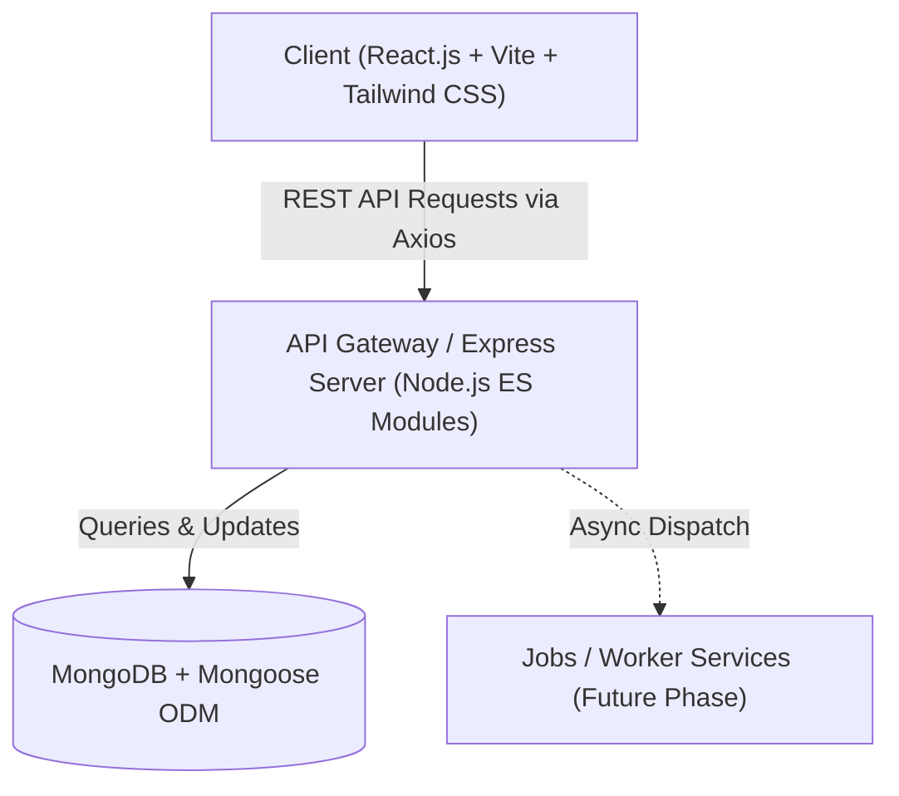
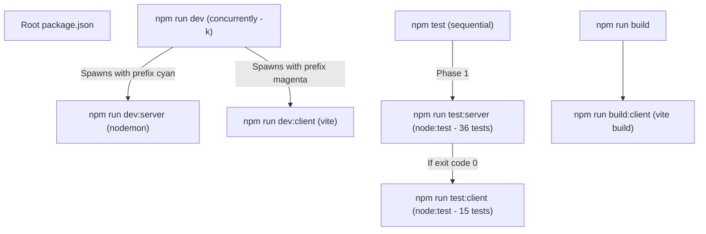
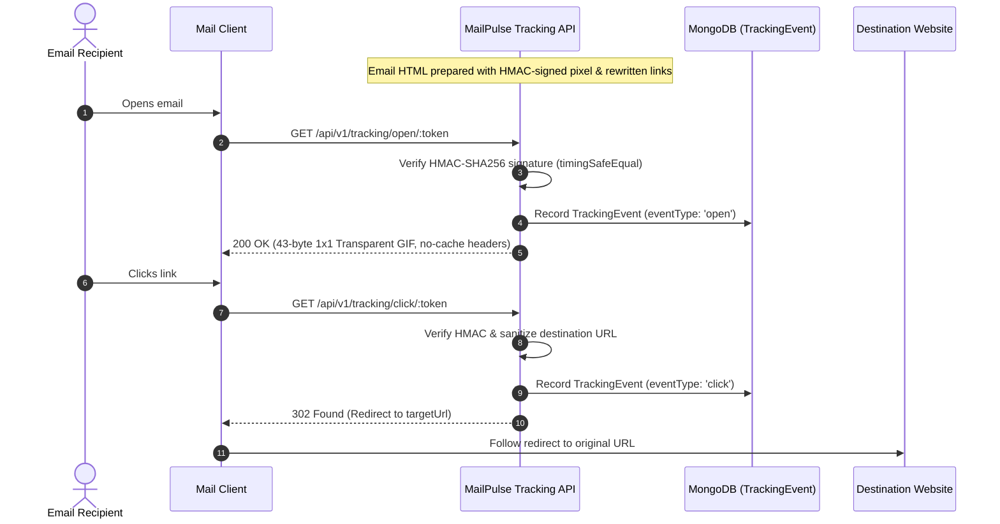

# MailPulse Architecture

## 1. System Overview

**MailPulse** is a modern, full-stack email campaign management and analytics platform built on the MERN stack (MongoDB, Express.js, React.js, Node.js). It provides creators, marketers, and developers with reliable contact management, automated campaign scheduling, real-time email delivery tracking, and performance analytics.



---

## 2. Technology Stack

### Frontend
- **Framework / Runtime**: React 19, Vite
- **Styling**: Tailwind CSS
- **Routing**: React Router (`react-router-dom`)
- **HTTP Client**: Axios
- **Data Visualization**: Recharts

### Backend
- **Runtime**: Node.js (ES Modules)
- **Framework**: Express.js
- **Database & ODM**: MongoDB, Mongoose
- **Security & Headers**: Helmet, CORS
- **Rate Limiting**: express-rate-limit
- **Validation**: Zod
- **Logging**: Morgan
- **Testing**: Node.js Native Test Runner (`node:test`)
- **Development**: Nodemon

---

## 3. Architecture Layers

MailPulse follows a modular, layered architecture to maintain clear separation of concerns:

```
MailPulse/
├── Presentation Layer (client/)
│   ├── Components (common, layout, contacts, campaigns)
│   ├── Pages (auth, dashboard, contacts, campaigns, analytics)
│   └── State & Services (context, hooks, services, utils)
│
├── API & Routing Layer (server/src/routes, middleware)
│   ├── Security Middleware (Helmet, CORS, Rate Limit)
│   ├── Request Validation (Zod schemas)
│   └── Error Handling (centralized error middleware)
│
├── Business Logic Layer (server/src/services, controllers, jobs)
│   ├── Controllers (Request orchestration)
│   ├── Services (Domain & business logic)
│   └── Background Jobs (Asynchronous tasks)
│
└── Data Layer (server/src/models, config/db.js)
    ├── Mongoose Schemas & Models
    └── MongoDB Connection Management
```

---

## 4. Directory Structure and Responsibilities

| Directory | Layer / Purpose | Phase |
| :--- | :--- | :--- |
| `client/src/components/common` | Reusable UI atoms and primitives (buttons, inputs, modals, badges) | Foundation / Ready |
| `client/src/components/layout` | Shell layout, navigation bar, sidebar, footer | Foundation / Ready |
| `client/src/components/contacts` | Contact lists, table views, tag managers | Future Phase |
| `client/src/components/campaigns` | Campaign creation wizards, template previewers | Future Phase |
| `client/src/pages/auth` | Login, registration, password recovery views | Future Phase |
| `client/src/pages/dashboard` | Main operational dashboard and overview metrics | Future Phase |
| `client/src/pages/contacts` | Audience and contact management views | Future Phase |
| `client/src/pages/campaigns` | Campaign overview and creation views | Future Phase |
| `client/src/pages/analytics` | Email open rates, click tracking, delivery reports | Future Phase |
| `client/src/hooks` | Custom React hooks for data fetching and UI state | Foundation / Ready |
| `client/src/services` | Axios API service wrappers | Foundation / Ready |
| `client/src/context` | Global React contexts (Auth, Theme, Notifications) | Foundation / Ready |
| `client/src/utils` | Client-side formatters, helpers, and validators | Foundation / Ready |
| `server/src/config` | Database connection (`db.js`) and environment configs | Foundation |
| `server/src/middleware` | Centralized error handler, auth guards, rate limiters | Foundation |
| `server/src/routes` | Route definitions (`health.routes.js`, future resource routes) | Foundation |
| `server/src/validators` | Request validation logic and reusable Zod schemas | Foundation |
| `server/src/controllers` | HTTP request handlers mapping to services | Future Phase |
| `server/src/models` | Mongoose data models and schemas | Future Phase |
| `server/src/services` | Core business logic and email delivery integrations | Future Phase |
| `server/src/jobs` | Background queues and scheduled campaign dispatchers | Future Phase |
| `server/src/utils` | Server helper functions and loggers (`asyncHandler.js`) | Foundation |
| `server/tests` | Integration and unit tests (`node:test`) | Foundation / Active |

---

## 5. Security, Reliability & Configuration Review

### 1. Security Headers (Helmet)
Helmet applies modern HTTP security headers:
- `X-Content-Type-Options: nosniff`: Prevents MIME-type sniffing.
- `Strict-Transport-Security (HSTS)`: Enforces HTTPS in production.
- `X-Frame-Options: SAMEORIGIN`: Defends against clickjacking.
- `Cross-Origin-Resource-Policy: cross-origin`: Allows approved web clients to fetch API resources without CORP browser blocks.

### 2. CORS Configuration
- **Allowed Origins**: Configured dynamically via `CLIENT_URL`. Supports comma-separated origin lists (e.g. `http://localhost:5173,https://app.mailpulse.io`).
- **Unapproved Origins**: Returns `callback(null, false)`, cleanly omitting `Access-Control-Allow-Origin` so browsers block the cross-origin request without crashing the server.
- **Server/Non-browser Requests**: Requests without an `Origin` header (curl, mobile apps, server-to-server) are permitted.

### 3. Request Body Limits & Parsing
- `1mb` body limits on `express.json()` and `express.urlencoded()`. This defends against memory exhaustion attacks while leaving ample space for complex campaign templates.
- **Malformed JSON Protection**: JSON syntax errors produce a sanitized HTTP `400 Bad Request` (`"Malformed JSON in request body"`) rather than leaking internal parser traces or returning HTTP 500.
- **Oversized Payload Protection**: Requests exceeding 1mb return HTTP `413 Payload Too Large`.
- Contact CSV/spreadsheet uploads in later phases will use dedicated multipart streaming validation rather than inflated JSON limits.

### 4. Rate Limiting
- General API limiter mounted at `/api` configured via `RATE_LIMIT_WINDOW_MS` (default 15m) and `RATE_LIMIT_MAX` (default 100 requests).
- Implements standard `draft-7` headers (`RateLimit-Limit`, `RateLimit-Remaining`, `RateLimit-Reset`).
- **Production Scaling Consideration**: In multi-instance / clustered deployments (Kubernetes, AWS ECS), the default in-memory store should be backed by a shared Redis cache (`rate-limit-redis`) to prevent per-instance limit multiplication.

### 5. Logging Strategy (Morgan)
- **Development**: Uses `'dev'` format for color-coded, readable request inspection.
- **Production**: Uses standard `'combined'` format for structured access logs.
- **Test Mode**: Automatically disabled during automated testing to avoid polluting test output.
- **Health Check Filter**: Skips logging successful health probes (`HTTP < 400` on `/api/v1/health`) to prevent log volume saturation, while continuing to log any failed probes (`503`).
- **Data Protection**: Never logs request bodies, passwords, access tokens, or database connection strings.

### 6. Environment Isolation
- Secrets are kept exclusively in local `.env` files (ignored by Git).
- [server/.env.example](file:///Users/denishahalpara/Desktop/MailPulse/server/.env.example) maintains template configuration with zero real secrets.
- Environment variables are resolved relative to the module root, ensuring reliable loading whether invoked from the repo root or server directory.

---

## 6. Server Startup and Graceful Shutdown Architecture

### 1. Startup Lifecycle
MailPulse enforces an asynchronous bootstrap sequence to ensure that the application never accepts client traffic until all prerequisite dependencies are ready:
1. **Environment Loading**: Module-relative `dotenv` resolution loads configuration from `server/.env`.
2. **Duplicate Prevention**: Tracks server listening state; redundant `startServer()` calls return the active instance without opening duplicate ports.
3. **Database Pre-requisite**: Executes `await connectDB()` before opening the HTTP port. If MongoDB is unavailable or `MONGODB_URI` is undefined, startup fails fast and terminates with `process.exit(1)`.
4. **Port Binding**: Only after MongoDB connection succeeds does `app.listen(PORT)` bind to incoming traffic.

```
Bootstrap Sequence:
  dotenv.config()
       │
       ▼
  connectDB() ─── Failure? ──► Log sanitized error & process.exit(1)
       │
    Success
       ▼
  app.listen(PORT) ──► Server ready to accept traffic
```

### 2. Graceful Shutdown Lifecycle
Upon receiving termination signals (`SIGTERM` from container runtimes or `SIGINT` via Ctrl+C), MailPulse executes a clean draining procedure:
1. **Idempotency Guard**: An internal boolean guard ensures subsequent signals do not trigger redundant shutdown cycles.
2. **Bounded Timeout**: Starts a bounded timer (default `10,000ms`, configurable via `SHUTDOWN_TIMEOUT_MS`). If in-flight requests stall, the timer triggers forced socket termination (`server.closeAllConnections()`) and aborts with exit code `1`.
3. **HTTP Connection Draining**:
   - Calls `server.close()` to stop accepting new HTTP connections.
   - Invokes `server.closeIdleConnections()` so idle keep-alive connections are terminated immediately without delaying shutdown.
   - Waits for active in-flight requests to complete.
4. **Database Connection Closure**: Calls `await mongoose.connection.close(false)` to flush any pending buffer writes and disconnect cleanly from MongoDB.
5. **Clean Exit**: Cancels the timeout timer and exits with code `0`.

```
Shutdown Sequence (SIGTERM / SIGINT):
  Signal Received
       │
       ▼
  Idempotency Check (prevent duplicate executions)
       │
       ▼
  Arm Bounded Timer (SHUTDOWN_TIMEOUT_MS = 10000ms)
       │
       ▼
  server.closeIdleConnections() & server.close() (drain active requests)
       │
       ▼
  mongoose.connection.close(false) (clean database flush)
       │
       ▼
  clearTimeout(timer) & process.exit(0)
```

### 3. Limitations & Considerations
- **Single-Process Scope**: Graceful shutdown handles in-flight HTTP requests and MongoDB connections for the local Node.js process. In clustered deployments (e.g. PM2 or Kubernetes with multiple replicas), each container instance manages its own shutdown lifecycle independently.
- **Background Jobs**: Background campaign workers (implemented in future phases) will require registering custom draining hooks into the shutdown pipeline to allow in-flight email batches to complete or release queue locks.

---

## 7. Frontend API Connectivity & Health Monitoring Architecture

### 1. Centralized API Client (`client/src/lib/api.js`)
- **Dynamic Base URL Resolution**: Resolves `VITE_API_BASE_URL` from Vite client environment (`import.meta.env`) with safe Node.js process environment fallback for headless testing, defaulting to `http://localhost:5000/api/v1`.
- **Validation & Development Warnings**: Validates URL scheme format and emits clean console warnings when configuration is missing or malformed without leaking secrets or credentials.
- **Timeout & Headers**: Configures a 10-second request timeout (`timeout: 10000`) and standard JSON headers (`Content-Type: application/json`, `Accept: application/json`).
- **Service Layer Compatibility**: Re-exported through `client/src/services/api.js` for flexible import conventions.

### 2. Health Probes (`client/src/api/health.js`)
- **Liveness Probe (`getLiveness`)**: Calls `GET /health` to confirm the Express server process is alive and accepting traffic.
- **Readiness Probe (`getReadiness`)**: Calls `GET /health/ready` to verify MongoDB database connectivity. Implements custom `validateStatus` accepting HTTP 503 as an informative status response rather than a transport error, allowing the UI to present a meaningful "Database Not Ready" state rather than crashing.
- **Combined Probe (`checkHealth`)**: Executes both probes concurrently via `Promise.allSettled`.
- **Request Cancellation**: All health functions forward Axios request options, enabling `AbortSignal` attachment for clean component unmount cancellation.

### 3. In-App Connectivity Component (`client/src/components/common/ConnectivityCheck.jsx`)
- **State Machine**: Supports Loading, Success, and Failure states.
- **Dual Indicators**: Distinguishes process liveness (API online) from database readiness (MongoDB connected).
- **Sanitized Failure States**: Renders friendly diagnostic guidance when the backend is unreachable without displaying raw stack traces or internal environment variables.
- **Unmount Protection**: Uses `AbortController` in `useEffect` cleanup to cancel in-flight requests and prevent state updates on unmounted components.
- **Interactive Retry**: Includes a manual "Re-check" button to verify reconnection without requiring full browser reload.

---

## 8. Monorepo Script Architecture & Process Lifecycle

The project utilizes npm monorepo workspaces (`client` and `server`) managed through unified root scripts in `package.json`:



- **Process Lifecycle Safety**: `npm run dev` employs `concurrently -k` so that terminating the parent process (via Ctrl+C or SIGINT/SIGTERM) forwards termination signals to both child processes, preventing orphaned port bindings.
- **Zero-Dependency Native Testing**: Both workspaces run Node.js native test runner (`node:test`), delivering 51 fast, zero-overhead automated tests across 9 test suites without third-party test framework overhead.

---

## 9. Open & Click Tracking Architecture (Phase 7)

MailPulse features a high-performance, cryptographically secure email engagement tracking engine:



### Key Security & Architectural Principles:
1. **Tamper-Proof URL-Safe Tokens**:
   - Tracking tokens consist of base64url JSON payload concatenated with an HMAC-SHA256 signature (`<payload>.<signature>`).
   - Verified using constant-time comparison (`crypto.timingSafeEqual`) to eliminate timing attacks.
   - Click tokens directly embed the target URL, eliminating database lookups on redirect while preventing tampering.
2. **Open-Redirect Protections**:
   - Redirection targets are strictly validated to adhere to `http:` or `https:`. Malformed or dangerous schemes (`javascript:`, `data:`, relative paths) are immediately rejected with HTTP 400 Bad Request.
3. **Anti-Caching & Silent Degradation**:
   - Open pixel responses set aggressive anti-caching HTTP headers so subsequent opens are reliably counted.
   - Corrupted or invalid open tokens log security warnings but safely serve the transparent GIF, avoiding broken image indicators in user inboxes.
4. **Aggregated Analytics Engine**:
   - MongoDB aggregation pipelines calculate total opens, unique opens, open rate %, total clicks, unique clicks, click-through rate (CTR %), per-link performance, and recent activity timelines.


