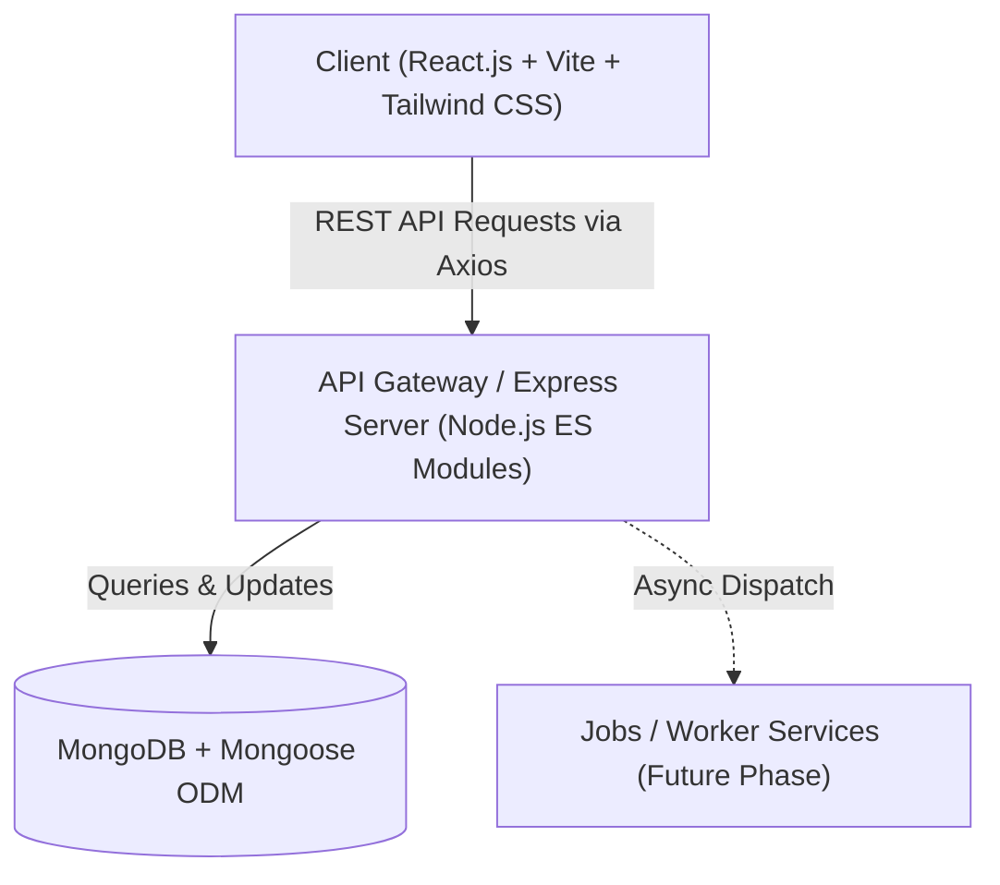
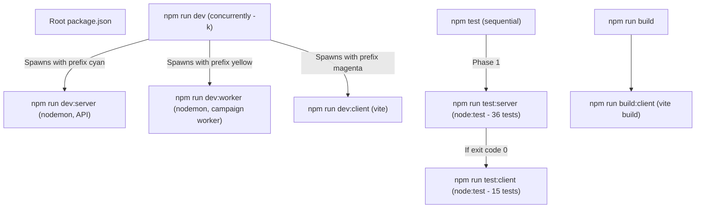
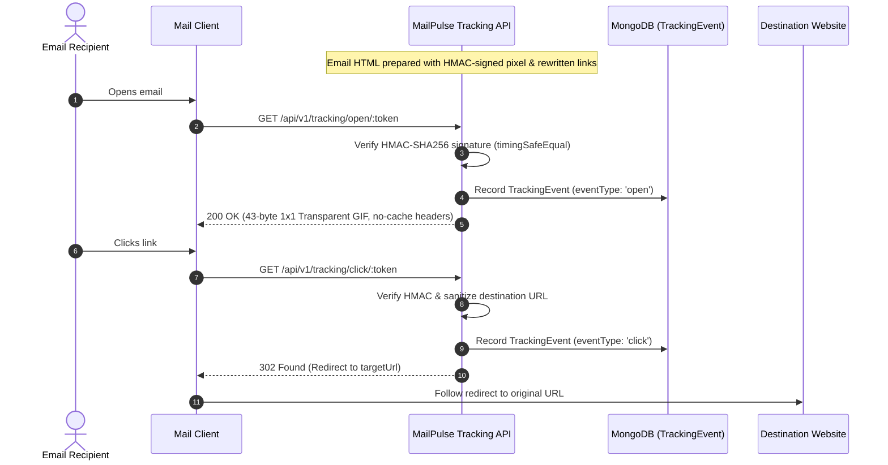
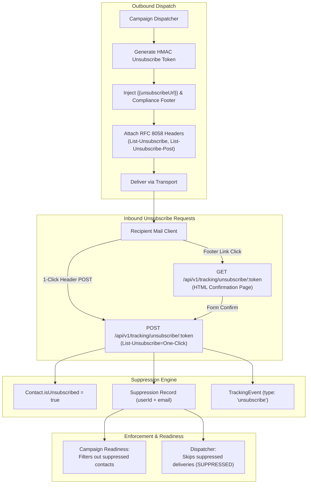
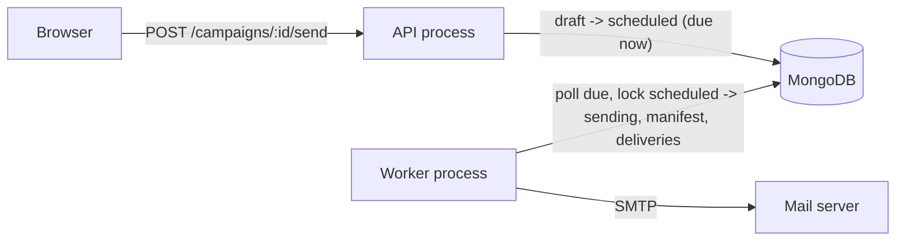

# MailPulse Architecture

## 1. System Overview

**MailPulse** is a modern, full-stack email campaign management and analytics platform built on the MERN stack (MongoDB, Express.js, React.js, Node.js). It provides creators, marketers, and developers with reliable contact management, automated campaign scheduling, real-time email delivery tracking, and performance analytics.



---

## 2. Technology Stack

### Frontend
- **Framework / Runtime**: React 19, Vite
- **Styling**: Tailwind CSS
- **Routing**: React Router (`react-router-dom`)
- **HTTP Client**: Axios
- **Data Visualization**: Recharts

### Backend
- **Runtime**: Node.js (ES Modules)
- **Framework**: Express.js
- **Database & ODM**: MongoDB, Mongoose
- **Security & Headers**: Helmet, CORS
- **Rate Limiting**: express-rate-limit
- **Validation**: Zod
- **Logging**: Morgan
- **Testing**: Node.js Native Test Runner (`node:test`)
- **Development**: Nodemon

---

## 3. Architecture Layers

MailPulse follows a modular, layered architecture to maintain clear separation of concerns:

```
MailPulse/
├── Presentation Layer (client/)
│   ├── Components (common, layout, contacts, campaigns)
│   ├── Pages (auth, dashboard, contacts, campaigns, analytics)
│   └── State & Services (context, hooks, services, utils)
│
├── API & Routing Layer (server/src/routes, middleware)
│   ├── Security Middleware (Helmet, CORS, Rate Limit)
│   ├── Request Validation (Zod schemas)
│   └── Error Handling (centralized error middleware)
│
├── Business Logic Layer (server/src/services, controllers, jobs)
│   ├── Controllers (Request orchestration)
│   ├── Services (Domain & business logic)
│   └── Background Jobs (Asynchronous tasks)
│
└── Data Layer (server/src/models, config/db.js)
    ├── Mongoose Schemas & Models
    └── MongoDB Connection Management
```

---

## 4. Directory Structure and Responsibilities

| Directory | Layer / Purpose | Phase |
| :--- | :--- | :--- |
| `client/src/components/common` | Reusable UI atoms and primitives (buttons, inputs, modals, badges) | Foundation / Ready |
| `client/src/components/layout` | Shell layout, navigation bar, sidebar, footer | Foundation / Ready |
| `client/src/components/contacts` | Contact lists, table views, tag managers | Future Phase |
| `client/src/components/campaigns` | Campaign creation wizards, template previewers | Future Phase |
| `client/src/pages/auth` | Login, registration, password recovery views | Future Phase |
| `client/src/pages/dashboard` | Main operational dashboard and overview metrics | Future Phase |
| `client/src/pages/contacts` | Audience and contact management views | Future Phase |
| `client/src/pages/campaigns` | Campaign overview and creation views | Future Phase |
| `client/src/pages/analytics` | Email open rates, click tracking, delivery reports | Future Phase |
| `client/src/hooks` | Custom React hooks for data fetching and UI state | Foundation / Ready |
| `client/src/services` | Axios API service wrappers | Foundation / Ready |
| `client/src/context` | Global React contexts (Auth, Theme, Notifications) | Foundation / Ready |
| `client/src/utils` | Client-side formatters, helpers, and validators | Foundation / Ready |
| `server/src/config` | Database connection (`db.js`) and environment configs | Foundation |
| `server/src/middleware` | Centralized error handler, auth guards, rate limiters | Foundation |
| `server/src/routes` | Route definitions (`health.routes.js`, future resource routes) | Foundation |
| `server/src/validators` | Request validation logic and reusable Zod schemas | Foundation |
| `server/src/controllers` | HTTP request handlers mapping to services | Future Phase |
| `server/src/models` | Mongoose data models and schemas | Future Phase |
| `server/src/services` | Core business logic and email delivery integrations | Future Phase |
| `server/src/jobs` | Background queues and scheduled campaign dispatchers | Future Phase |
| `server/src/utils` | Server helper functions and loggers (`asyncHandler.js`) | Foundation |
| `server/tests` | Integration and unit tests (`node:test`) | Foundation / Active |

---

## 5. Security, Reliability & Configuration Review

### 1. Security Headers (Helmet)
Helmet applies modern HTTP security headers:
- `X-Content-Type-Options: nosniff`: Prevents MIME-type sniffing.
- `Strict-Transport-Security (HSTS)`: Enforces HTTPS in production.
- `X-Frame-Options: SAMEORIGIN`: Defends against clickjacking.
- `Cross-Origin-Resource-Policy: cross-origin`: Allows approved web clients to fetch API resources without CORP browser blocks.

### 2. CORS Configuration
- **Allowed Origins**: Configured dynamically via `CLIENT_URL`. Supports comma-separated origin lists (e.g. `http://localhost:5173,https://app.mailpulse.io`).
- **Unapproved Origins**: Returns `callback(null, false)`, cleanly omitting `Access-Control-Allow-Origin` so browsers block the cross-origin request without crashing the server.
- **Server/Non-browser Requests**: Requests without an `Origin` header (curl, mobile apps, server-to-server) are permitted.

### 3. Request Body Limits & Parsing
- `1mb` body limits on `express.json()` and `express.urlencoded()`. This defends against memory exhaustion attacks while leaving ample space for complex campaign templates.
- **Malformed JSON Protection**: JSON syntax errors produce a sanitized HTTP `400 Bad Request` (`"Malformed JSON in request body"`) rather than leaking internal parser traces or returning HTTP 500.
- **Oversized Payload Protection**: Requests exceeding 1mb return HTTP `413 Payload Too Large`.
- Contact CSV/spreadsheet uploads in later phases will use dedicated multipart streaming validation rather than inflated JSON limits.

### 4. Rate Limiting
- General API limiter mounted at `/api` configured via `RATE_LIMIT_WINDOW_MS` (default 15m) and `RATE_LIMIT_MAX` (default 100 requests).
- Implements standard `draft-7` headers (`RateLimit-Limit`, `RateLimit-Remaining`, `RateLimit-Reset`).
- **Production Scaling Consideration**: In multi-instance / clustered deployments (Kubernetes, AWS ECS), the default in-memory store should be backed by a shared Redis cache (`rate-limit-redis`) to prevent per-instance limit multiplication.

### 5. Logging Strategy (Morgan)
- **Development**: Uses `'dev'` format for color-coded, readable request inspection.
- **Production**: Uses standard `'combined'` format for structured access logs.
- **Test Mode**: Automatically disabled during automated testing to avoid polluting test output.
- **Health Check Filter**: Skips logging successful health probes (`HTTP < 400` on `/api/v1/health`) to prevent log volume saturation, while continuing to log any failed probes (`503`).
- **Data Protection**: Never logs request bodies, passwords, access tokens, or database connection strings.

### 6. Environment Isolation
- Secrets are kept exclusively in local `.env` files (ignored by Git).
- [server/.env.example](file:///Users/denishahalpara/Desktop/MailPulse/server/.env.example) maintains template configuration with zero real secrets.
- Environment variables are resolved relative to the module root, ensuring reliable loading whether invoked from the repo root or server directory.

---

## 6. Server Startup and Graceful Shutdown Architecture

### 1. Startup Lifecycle
MailPulse enforces an asynchronous bootstrap sequence to ensure that the application never accepts client traffic until all prerequisite dependencies are ready:
1. **Environment Loading**: Module-relative `dotenv` resolution loads configuration from `server/.env`.
2. **Duplicate Prevention**: Tracks server listening state; redundant `startServer()` calls return the active instance without opening duplicate ports.
3. **Database Pre-requisite**: Executes `await connectDB()` before opening the HTTP port. If MongoDB is unavailable or `MONGODB_URI` is undefined, startup fails fast and terminates with `process.exit(1)`.
4. **Port Binding**: Only after MongoDB connection succeeds does `app.listen(PORT)` bind to incoming traffic.

```
Bootstrap Sequence:
  dotenv.config()
       │
       ▼
  connectDB() ─── Failure? ──► Log sanitized error & process.exit(1)
       │
    Success
       ▼
  app.listen(PORT) ──► Server ready to accept traffic
```

### 2. Graceful Shutdown Lifecycle
Upon receiving termination signals (`SIGTERM` from container runtimes or `SIGINT` via Ctrl+C), MailPulse executes a clean draining procedure:
1. **Idempotency Guard**: An internal boolean guard ensures subsequent signals do not trigger redundant shutdown cycles.
2. **Bounded Timeout**: Starts a bounded timer (default `10,000ms`, configurable via `SHUTDOWN_TIMEOUT_MS`). If in-flight requests stall, the timer triggers forced socket termination (`server.closeAllConnections()`) and aborts with exit code `1`.
3. **HTTP Connection Draining**:
   - Calls `server.close()` to stop accepting new HTTP connections.
   - Invokes `server.closeIdleConnections()` so idle keep-alive connections are terminated immediately without delaying shutdown.
   - Waits for active in-flight requests to complete.
4. **Database Connection Closure**: Calls `await mongoose.connection.close(false)` to flush any pending buffer writes and disconnect cleanly from MongoDB.
5. **Clean Exit**: Cancels the timeout timer and exits with code `0`.

```
Shutdown Sequence (SIGTERM / SIGINT):
  Signal Received
       │
       ▼
  Idempotency Check (prevent duplicate executions)
       │
       ▼
  Arm Bounded Timer (SHUTDOWN_TIMEOUT_MS = 10000ms)
       │
       ▼
  server.closeIdleConnections() & server.close() (drain active requests)
       │
       ▼
  mongoose.connection.close(false) (clean database flush)
       │
       ▼
  clearTimeout(timer) & process.exit(0)
```

### 3. Limitations & Considerations
- **Single-Process Scope**: Graceful shutdown handles in-flight HTTP requests and MongoDB connections for the local Node.js process. In clustered deployments (e.g. PM2 or Kubernetes with multiple replicas), each container instance manages its own shutdown lifecycle independently.
- **Background Jobs**: campaign sending runs only in the worker process (section 13). The API and the worker share one bounded shutdown routine (`server/src/utils/gracefulShutdown.js`): close the HTTP listener (API requests, or the worker's health endpoint), stop the scheduler, stop dispatching (in-flight watchdog sweeps, recoveries and sends are awaited, leases released), close MongoDB.

---

## 7. Frontend API Connectivity & Health Monitoring Architecture

### 1. Centralized API Client (`client/src/lib/api.js`)
- **Dynamic Base URL Resolution**: Resolves `VITE_API_BASE_URL` from Vite client environment (`import.meta.env`) with safe Node.js process environment fallback for headless testing, defaulting to `http://localhost:5000/api/v1`.
- **Validation & Development Warnings**: Validates URL scheme format and emits clean console warnings when configuration is missing or malformed without leaking secrets or credentials.
- **Timeout & Headers**: Configures a 10-second request timeout (`timeout: 10000`) and standard JSON headers (`Content-Type: application/json`, `Accept: application/json`).
- **Service Layer Compatibility**: Re-exported through `client/src/services/api.js` for flexible import conventions.

### 2. Health Probes (`client/src/api/health.js`)
- **Liveness Probe (`getLiveness`)**: Calls `GET /health` to confirm the Express server process is alive and accepting traffic.
- **Readiness Probe (`getReadiness`)**: Calls `GET /health/ready` to verify MongoDB database connectivity. Implements custom `validateStatus` accepting HTTP 503 as an informative status response rather than a transport error, allowing the UI to present a meaningful "Database Not Ready" state rather than crashing.
- **Combined Probe (`checkHealth`)**: Executes both probes concurrently via `Promise.allSettled`.
- **Request Cancellation**: All health functions forward Axios request options, enabling `AbortSignal` attachment for clean component unmount cancellation.

### 3. In-App Connectivity Component (`client/src/components/common/ConnectivityCheck.jsx`)
- **State Machine**: Supports Loading, Success, and Failure states.
- **Dual Indicators**: Distinguishes process liveness (API online) from database readiness (MongoDB connected).
- **Sanitized Failure States**: Renders friendly diagnostic guidance when the backend is unreachable without displaying raw stack traces or internal environment variables.
- **Unmount Protection**: Uses `AbortController` in `useEffect` cleanup to cancel in-flight requests and prevent state updates on unmounted components.
- **Interactive Retry**: Includes a manual "Re-check" button to verify reconnection without requiring full browser reload.

---

## 8. Monorepo Script Architecture & Process Lifecycle

The project utilizes npm monorepo workspaces (`client` and `server`) managed through unified root scripts in `package.json`:



- **Process Lifecycle Safety**: `npm run dev` employs `concurrently -k` so that terminating the parent process (via Ctrl+C or SIGINT/SIGTERM) forwards termination signals to every child process (API, worker, client), preventing orphaned port bindings. Without the worker, campaigns are queued but not sent.
- **Zero-Dependency Native Testing**: Both workspaces run Node.js native test runner (`node:test`), delivering 51 fast, zero-overhead automated tests across 9 test suites without third-party test framework overhead.

---

## 9. Open & Click Tracking Architecture (Phase 7)

MailPulse features a high-performance, cryptographically secure email engagement tracking engine:



### Key Security & Architectural Principles:
1. **Tamper-Proof URL-Safe Tokens**:
   - Tracking tokens consist of base64url JSON payload concatenated with an HMAC-SHA256 signature (`<payload>.<signature>`).
   - Verified using constant-time comparison (`crypto.timingSafeEqual`) to eliminate timing attacks.
   - Click tokens directly embed the target URL, eliminating database lookups on redirect while preventing tampering.
2. **Open-Redirect Protections**:
   - Redirection targets are strictly validated to adhere to `http:` or `https:`. Malformed or dangerous schemes (`javascript:`, `data:`, relative paths) are immediately rejected with HTTP 400 Bad Request.
3. **Anti-Caching & Silent Degradation**:
   - Open pixel responses set aggressive anti-caching HTTP headers so subsequent opens are reliably counted.
   - Corrupted or invalid open tokens log security warnings but safely serve the transparent GIF, avoiding broken image indicators in user inboxes.
4. **Aggregated Analytics Engine**:
   - MongoDB aggregation pipelines calculate total opens, unique opens, open rate %, total clicks, unique clicks, click-through rate (CTR %), per-link performance, and recent activity timelines.

---

## 10. Unsubscribe & Suppression Management Architecture (Phase 8)

MailPulse implements full-lifecycle unsubscribe handling and suppression enforcement in compliance with CAN-SPAM, GDPR, and RFC 8058:



### Key Security & Architectural Principles:
1. **RFC 8058 One-Click Native Headers**:
   - Outbound campaign emails include `List-Unsubscribe: <https://.../api/v1/tracking/unsubscribe/:token>` and `List-Unsubscribe-Post: List-Unsubscribe=One-Click`.
   - Major email providers (Gmail, Yahoo, Apple Mail) render native "Unsubscribe" buttons at the top of incoming messages that trigger silent, one-click opt-out without human login friction.
2. **Multi-Tenant Suppression Isolation**:
   - The `Suppression` collection maintains a unique compound index on `{ userId: 1, email: 1 }`.
   - If an account owner deletes a contact and subsequently re-adds or re-imports the same email, the recipient's suppression status remains permanently enforced for that account.
3. **Double-Layered Dispatch & Readiness Protection**:
   - **Readiness Gate**: `evaluateCampaignReadiness` queries active suppressions and excludes unsubscribed contacts from eligible recipients, reporting `unsubscribedRecipientsCount` in the summary.
   - **Dispatcher Gate**: In `processNextDelivery`, a real-time check verifies that neither the contact nor the email address has opted out between campaign creation and send execution. Suppressed recipients are cleanly marked `failed` with error code `SUPPRESSED` without invoking the SMTP transport.

---

## 11. Scheduled Campaign Dispatch Architecture (Phase 9)

MailPulse provides automated, background-scheduled campaign dispatches with strict race-condition guarantees:

```mermaid
flowchart TD
    Draft["Campaign (draft)"] -->|POST /:id/schedule| Scheduled["Campaign (scheduled)\nscheduledAt: Future Date"]
    Draft -->|POST /:id/send (send now)| Queued["Campaign (scheduled)\nscheduledAt: database now"]
    Scheduled -->|POST /:id/cancel-schedule| Draft
    Queued -->|POST /:id/cancel-schedule| Draft
    Scheduled -->|POST /:id/schedule| Scheduled

    subgraph Worker process only
        Timer["Interval Poller (CAMPAIGN_SCHEDULER_INTERVAL_MS, 15s)"] -->|Find due campaigns| Query["status: 'scheduled' AND scheduledAt <= worker now"]
        Query --> Readiness{"Re-evaluate Readiness\n& Owner Status"}
        Readiness -->|Unready or Suspended| Fail["status: 'failed'"]
        Readiness -->|Valid| AtomicLock["startCampaignDispatch(): atomic lock\nstatus 'scheduled' AND scheduledAt <= MongoDB $$NOW\nAND same version AND no manifest -> 'sending'"]
    end
```

### Key Guarantees & Design:
1. **Double-Dispatch Prevention & Atomic Claims**:
   - "Send now" (`POST /:id/send`) does not send: it atomically moves the evaluated draft to `scheduled` with `scheduledAt` set to MongoDB's current time. Sending is always done by the worker's scheduler, so there is one path into `sending`.
   - The scheduler queries for due campaigns where `status: 'scheduled'` and `scheduledAt <= now` (the worker's clock), re-evaluates readiness, then locks.
   - The lock (`startCampaignDispatch`) is one atomic update that matches only a campaign still `scheduled`, still the evaluated version, never locked before (no manifest), and due by **MongoDB's** clock (`$expr: { $lte: ['$scheduledAt', '$$NOW'] }`). Overlapping polls, several workers, a worker whose clock runs ahead, a reschedule or a cancel racing the poll: at most one lock succeeds and the others change nothing. A draft can never be locked.
2. **Editing & Deletion Locks**:
   - Scheduled campaigns are locked from mutations (`PATCH` and `DELETE` return HTTP `409 Conflict`), requiring an explicit schedule cancellation first.
3. **Graceful Lifecycle Management**:
   - The scheduler runs only in the worker process, alongside the dispatch watchdog, and terminates safely on `SIGTERM` / `SIGINT`, awaiting any in-flight poll before dispatches are stopped and the database connection closes.
   - Tests drive it explicitly (`pollScheduledCampaigns`, or `tests/helpers/queuedSend.js` for "send now").

---

## 12. Multi-Instance Dispatch Leases (Phase 13 / Stage 4A)

**Requirement: MongoDB 4.2 or newer** (update pipelines with `$$NOW`). CI and the Docker setup use MongoDB 7.

### Ownership model
- A campaign in `sending` carries `dispatchLeaseOwner` (the instance, for diagnostics), `dispatchLeaseUntil` and `dispatchLeaseEpoch`.
- **Every lease decision is made by the database using its own clock** (`$$NOW` inside one atomic update). Application servers never compare clocks, so a host with a wrong clock can neither take a live lease nor hold a dead one.
- Acquisition succeeds only when the lease is absent, released or expired, and exactly one concurrent caller wins. Each change of owner increases the **epoch** by one; the epoch is never reset, not even by a release.
- **Renewal is strict:** it succeeds only for the exact owner and epoch **and only while the lease is still unexpired by database time**. An expired lease is never revived, even if nobody has taken it yet. A worker that loses its lease this way stays fenced.
- A worker keeps the epoch it was granted (a `LeaseSession`). Renewal, the pre-claim check, delivery updates, statistics and finalization are all conditional on that exact owner and epoch. The process-wide `INSTANCE_ID` is not an acquisition identity.
- The draft/scheduled -> `sending` transition takes the lease in the same atomic update, so a campaign is never `sending` without an owner.
- The same update stores the campaign's dispatch manifest (version, count and recipients). It is written once: a campaign that already has one cannot be locked again. Deliveries are generated from it and verified before any claim.

### Per-delivery fencing (no transactions, no replica set)
Checking the lease and then claiming a delivery are two separate database operations, so a worker could verify its lease, stall, lose the lease, and still claim. That race is closed by making the **claim itself** the fence:

- **`Delivery.fence`** is the minimum lease epoch allowed to claim a *pending* delivery (absent/null = anyone). The claim is one atomic update on the delivery: it matches only `status: 'pending'` **and** (`fence` is absent/null **or** `fence <= myEpoch`), and sets `status: 'processing'`, `claimEpoch: myEpoch` and `attempts + 1`. A worker that has been taken over cannot match, whatever its local state says.
- **Takeover order** (`acquireLease` + `fenceDeliveriesBeforeTakeover`): (1) read the campaign if its lease is free/expired by *database* time and remember the **exact epoch observed** (absent/null counts as 0); (2) fence target = observed + 1; (3) raise the `fence` of every pending delivery to at least that target (`$max`, so a fence can never be lowered and repeating it is harmless); (4) only then perform the atomic acquire, a **compare-and-swap**: it matches only while the campaign epoch is *still exactly the observed one* **and** the lease is still free/expired by database time, and it sets epoch = observed + 1; (5) after acquiring, recovery records older-epoch `processing` deliveries as INTERRUPTED (and re-asserts the fence, idempotently). If step 3 fails, or the compare-and-swap loses, the lease is **not** acquired, nothing is recovered or dispatched, and the campaign stays eligible for another attempt at the next sweep.
- **Why a compare-and-swap:** without it, a taker that fenced for epoch 5 could pause while another taker acquired epoch 5 and let it lapse, then resume and be granted epoch 6 while the deliveries were fenced only to 5. For a moment the intermediate (now stale) epoch-5 owner could still claim. With the swap, the epoch granted on success always equals the fence target, and a stale taker simply gets nothing. This is covered by a real-process regression test that fails without the swap.
- **Why fencing happens before acquiring:** because the granted epoch equals the fence target, every delivery that was pending at fencing time refuses every older epoch from the moment the new owner holds the lease. Nothing ever moves a delivery from `processing` back to `pending`, so no later write can lower that protection.
- **Why the two orderings are safe:** each claim and each fence is a single-document atomic update, so on any one delivery exactly one wins. *Fence first:* the stale claim fails (and the worker, seeing pending deliveries fenced above its epoch, marks itself fenced out). *Claim first:* it was a legitimate pre-takeover claim; the delivery is `processing` under the old epoch (the fence only touches pending deliveries), and recovery records it INTERRUPTED and never resends it.
- **Concurrent takers:** several may fence (idempotent, never lowering); only one wins the compare-and-swap; the others get nothing and change no lease. A stale taker that finishes fencing late can only try to raise fences to its older target, which changes nothing, and its acquire fails. A fence never exceeds the epoch of whoever will hold the lease next, so the legitimate owner is never blocked.
- Before every claim the worker still performs one indexed read confirming its owner, epoch and unexpired lease. It is a fast exit and gives the diagnostic reason; it is **not** what makes the claim safe.
- The claim records `claimEpoch`. Its later `sent`/`failed` update is conditional on that epoch and on the delivery still being `processing`, so a stale worker cannot overwrite state written under a newer epoch.
- Statistics increments and finalization are conditional on the campaign still being `sending` under the worker's epoch; a late stale update changes nothing. Finalization takes its final status from the delivery counts, and only one concurrent caller can perform it.

### A worker that loses its lease after claiming
A delivery is **never** returned to `pending` once claimed. If a worker's fence trips after it has claimed a delivery (before the SMTP call, or while the message is being prepared), the worker sends nothing and stops, and the delivery stays `processing` under its claim epoch. The next legitimate owner's recovery records it `INTERRUPTED`; it is never claimed or sent again, and the stale worker's own later writes cannot touch it (they are conditional on the claim epoch and on the delivery still being `processing`). **Consequence:** a recipient who was provably never emailed can be skipped. This is deliberate: handing a claim back would require a write that a stale worker could land late, leaving the delivery claimable by an intermediate epoch, and preventing an unsafe retry matters more than preserving that one delivery. After the transport has been invoked the outcome is uncertain and is recorded `sent`, `TRANSPORT_ERROR` (the server refused it, or the failure came before any message data was sent), `SEND_UNCERTAIN` (socket timeout, dropped connection or any unclassified failure: the server may have accepted it), `PERSIST_ERROR` (accepted but not recorded) or `INTERRUPTED` (recovery); none of these can become `pending`.

**Pre-send contact check and its residual race.** After a worker atomically claims a delivery, it reads the recipient's live state once, immediately before building and sending the message: the owner's suppression list (by the locked address), then the contact by contact ID **and** owner ID. Outcomes, all terminal and never retried: `SUPPRESSED` (suppressed or unsubscribed), `CONTACT_REMOVED` (no such contact for this owner: deleted, or moved to another account; a contact deleted and re-created with the same address is a new contact and also `CONTACT_REMOVED`), `CONTACT_CHANGED` (its address differs from the manifest snapshot, ignoring letter case and surrounding spaces; neither the old nor the new address is emailed). The same read supplies the custom fields used for personalization, so no further database round trip sits between the check and the SMTP call. **Residual risk, stated plainly:** nothing locks the contact between that read and the moment the mail server accepts the message. A contact deleted, edited or unsubscribed during that window (message preparation, which is in-memory, plus the SMTP exchange, typically well under a second; a stalled server is abandoned by the connection, greeting and socket-inactivity timeouts, 5 s, 5 s and 8 s by default, although a server that keeps answering slowly can stretch the exchange further because the socket timeout measures inactivity) can still receive that one message; it is recorded `sent` (or `SEND_UNCERTAIN`) and nothing further is ever sent to it. Closing the window completely would need a lock that contact edits and deletions wait on for the length of an SMTP exchange; that is not implemented, so no absolute guarantee is claimed. `tests/contactEligibility.test.js` pins both the protections and this residual behaviour.

### Self-fencing
A worker that cannot confirm its lease within 3/4 of the lease length (renewal failed, database unreachable, process stalled) fences itself: it stops claiming and **never resumes**, even after the database returns. "Cannot confirm" is measured with a monotonic local timer; this is used only to decide that the worker can no longer prove ownership, never to decide that a lease has expired.

### Recovery
- Startup recovery and the watchdog take the lease first (new epoch) and leave any campaign a live owner holds untouched. Deliveries still `processing` under an older epoch are recorded `INTERRUPTED`; they are **never re-sent**.
- Recovery only resumes a campaign with a valid **dispatch manifest** (the recipient list stored by the send lock). It completes delivery generation from that list and verifies the deliveries are exactly it before resuming. A campaign without a manifest, or with a damaged one, is refused untouched. See `docs/deployment/MANIFEST-UPGRADE.md`.
- A graceful shutdown **releases** its leases: a released lease is stamped as ended with the database's current time, so peers may take it immediately and the watchdog lists it at its next sweep (`CAMPAIGN_WATCHDOG_INTERVAL_MS`, default 5 minutes) instead of waiting for `CAMPAIGN_STALL_TIMEOUT_MS` (15 minutes). A crashed instance's lease lapses after `CAMPAIGN_LEASE_MS` (default 60 s). A campaign that never had a lease (for example one still running on an older version) is only recovered by the stall timeout.
- **Shutdown ordering.** `stopAllDispatches` first sets the stop flag (no sweep or recovery starts, no recovery hands a campaign to a dispatch, no dispatch starts, workers stop claiming), clears the watchdog timer, then awaits the watchdog sweep already running, every in-flight recovery (startup resume included) and every running dispatch, repeating until none is left, and only then releases leases; MongoDB is closed after that. A recovery that already holds a lease when shutdown begins finishes its idempotent database work (recording older in-flight deliveries `INTERRUPTED`, completing generation from the manifest) and gives the lease back instead of dispatching; its pending deliveries stay `pending` for the next owner. Lease, epoch and fencing rules are unchanged.

### Delivery guarantees, and what is NOT guaranteed
- **At most once per recipient per campaign.** This comes from the atomic delivery claim (`pending` -> `processing`), the unique `(campaign, contact)` delivery, and the rule that an uncertain delivery is never retried. It does not depend on leases or fences.
- **No new claims after a takeover completes.** Once a new owner holds the lease, a worker of an older epoch cannot claim any delivery that was pending when the takeover fenced it. This rests on the compare-and-swap (granted epoch == fence target) and on deliveries never returning to `pending`; it is exercised by the real-process tests, not proven in general. A worker that had *already claimed* a delivery before the fence reached it is the in-flight case below.
- **Not exactly-once, and not "exactly one active worker at every instant".** MongoDB and SMTP cannot share a transaction. A delivery that a worker *legitimately claimed before the takeover* may still be mid-send when the lease changes hands, and its send can complete afterwards. Likewise a worker that passed its last check may complete the one send it was about to make. Fencing bounds this to the deliveries already claimed (at most the configured send concurrency, default 5, maximum 20) and prevents any further claims, but it cannot close that window. Such a delivery is recorded INTERRUPTED although the email may have been sent, so `stats.sent` is a lower bound. No extra database read is made just before SMTP; the local fence is the last check.
- **No replica set or transaction is required.** The design uses only single-document atomic updates, so it works on a standalone MongoDB (as used by the Docker setup and CI) as well as on Atlas.
- `CAMPAIGN_SEND_RATE_PER_MINUTE` applies per instance.

### Tests
- `tests/dispatchLease.test.js`: single-process tests of acquisition, epochs, strict renewal, release, fencing, the takeover hook and its ordering, the compare-and-swap (concurrent takers, an epoch change after the read, missing/null/0 epochs, a lost swap starting no recovery), the delivery fence (including claim-versus-fence interleavings), the SMTP boundary (a claimed delivery never returns to `pending`), conditional updates, finalization and the watchdog candidates.
- `tests/dispatchLeaseMultiProcess.test.js` and `tests/dispatchFencing.test.js`: **real separate Node.js processes** sharing an isolated database, with a mock transport only: simultaneous acquisition and takeover, skewed clocks, renewal, takeover after SIGSTOP/SIGCONT, a worker frozen exactly between lease verification and claim, both claim/fence orderings, the stale-taker compare-and-swap regression, a stale taker finishing late, a fencing failure, a fence that trips after a claim (left `processing`, then `INTERRUPTED`), graceful-shutdown recovery, and a database outage with self-fencing. These tests do not prove behaviour across separate machines (network partitions, genuine clock drift), whole-machine freezes (a frozen local clock is emulated), or real SMTP.

---

## 13. Process Model: API and Worker

MailPulse runs as two Node.js processes built from the same code and image:

| Process | Entry point | Does | Never does |
| :--- | :--- | :--- | :--- |
| API | `server/src/server.js` (`npm run start:server`, Compose `server`) | HTTP API, authentication, campaign editing, readiness, queueing sends ("send now" and schedules), test emails and account emails (verification, password reset) | Lock or dispatch a campaign; it does not start the scheduler, startup resume or the watchdog |
| Worker | `server/src/worker.js` (`npm run start:worker`, Compose `worker`) | Scheduler (locks due campaigns, including queued "send now"), startup resume of interrupted campaigns, stalled-campaign watchdog, all campaign SMTP traffic | Serve the API |



- **Coordination is only through MongoDB.** There is no queue service, no Redis and no IPC. The queue is the campaign document (`status: 'scheduled'`, `scheduledAt`); ownership of a sending campaign is the lease and epoch described in section 12.
- **Worker health.** `GET /health` on `WORKER_HEALTH_HOST:WORKER_HEALTH_PORT` (default `127.0.0.1:5001`, loopback so only the container's own check reaches it) answers `200` while MongoDB is connected and the dispatch runtime runs, otherwise `503` (including from the start of shutdown). Every other path answers `404`. It reports only booleans.
- **Shutdown.** Both processes use the same ordered, bounded handler (section 6). For the worker: health endpoint closed, scheduler stopped (awaiting an in-flight poll), dispatching stopped (stop flag first, then the in-flight watchdog sweep, recoveries and sends are awaited, then leases released), MongoDB closed. `stop_grace_period` in Compose must stay longer than `SHUTDOWN_TIMEOUT_MS`.
- **Without a worker** nothing is lost: queued and scheduled campaigns wait, and campaigns left `sending` are recovered by the next worker without re-sending anything whose outcome is uncertain.
- **More than one worker** is safe (atomic due-time lock, leases with epochs, per-delivery fencing), but the first-client deployment runs one.
- **Latency.** A "send now" starts within one scheduler interval (`CAMPAIGN_SCHEDULER_INTERVAL_MS`, default 15 s, minimum 1 s).

### Delivery outcomes recorded by the worker

| Code | Meaning | Recipient emailed? | Ever re-sent? |
| :--- | :--- | :--- | :--- |
| `sent` (status) | The mail server accepted the message | Yes | No |
| `TRANSPORT_ERROR` | Refused by the server (4xx/5xx reply), or failed before any message data was sent (connect, greeting or STARTTLS timeout, DNS, authentication, connection refused) | No | No |
| `SEND_UNCERTAIN` | The send call failed in a way where the server may already have accepted it (socket inactivity timeout, connection dropped or reset without a reply, any unrecognised error) | Possibly | No |
| `INTERRUPTED` | The worker stopped while the delivery was in flight; recorded by the next owner's recovery | Possibly | No |
| `PERSIST_ERROR` | Accepted by the server, but recording `sent` failed | Very likely | No |
| `INVALID_MESSAGE` / `CONFIGURATION_ERROR` | Rejected before the transport was called | No | No |
| `SUPPRESSED` / `CONTACT_REMOVED` / `CONTACT_CHANGED` | Skipped by the pre-send contact check (section 12) | No | No |

Nothing retries a failed delivery automatically. The guarantee is **at most once** per recipient per campaign; `stats.sent` is a lower bound.

### Residual risks (stated, not solved)

- **Contact changes during an SMTP exchange.** The pre-send check reads the contact immediately before sending, but nothing locks it until the mail server accepts the message: a contact deleted, edited or unsubscribed in that window can still receive that one message.
- **Timeout classification depends on the SMTP library.** A connect, greeting or STARTTLS timeout is treated as "not sent" only when Nodemailer reports which timeout fired (`timeoutType`); otherwise the failure is recorded `SEND_UNCERTAIN`. That errs toward reporting a possible delivery, never toward re-sending.
- **Queued sends wait for a worker.** If no worker runs, "send now" campaigns stay queued (shown as *Queued* in the UI) until one starts; they are never sent by the API.
- **Single MongoDB.** The design relies on one MongoDB deployment (4.2+) and its server time; see section 12 for what the lease tests do and do not prove (no network partitions or real clock drift across machines).

## 14. OAuth Token Encryption at Rest

Campaign email will be sent through the Gmail API with each customer's own Google account. The OAuth tokens those accounts grant are encrypted by `server/src/utils/tokenCrypto.js` before they are stored. This section describes that utility only; the sender-account model, OAuth flow and Gmail transport come in later milestones and are not implemented yet.

### Design

- **Algorithm.** AES-256-GCM (Node `crypto`, no extra dependency) with a 32-byte key, a fresh 96-bit IV from the CSPRNG for every encryption, and the full 128-bit authentication tag, which is checked on every decryption.
- **Envelope.** `mpt1.<keyId>.<iv>.<ciphertext>.<tag>`, each binary part base64url-encoded. The version prefix and the key ID make rotation and future format changes possible without guessing.
- **Context binding.** Every call names a context (for example the sender account and token kind). The context, the version and the key ID are authenticated as additional data, so an envelope copied to another record, relabelled with another key ID or edited in any byte fails to decrypt.
- **Strict parsing, generic errors.** Malformed envelopes (wrong part count, unknown version, non-canonical base64url, wrong IV or tag length, empty or oversized ciphertext) are rejected before any decryption. Errors carry a code (`TOKEN_INVALID_CIPHERTEXT`, `TOKEN_UNKNOWN_KEY`, `TOKEN_DECRYPT_FAILED`, ...) and a fixed message; they never include a token, a key, an envelope or the underlying crypto error.
- **No plaintext fallback.** There is no "unencrypted" mode: without a configured key, encrypting and decrypting throw. A value that is not a valid envelope is never returned as-is.

### Configuration and startup

- `TOKEN_ENCRYPTION_KEYS` lists `keyId:base64Key` pairs; `TOKEN_ENCRYPTION_ACTIVE_KEY_ID` selects the key for new encryptions (required when several keys are listed). Keys must decode to exactly 32 bytes; placeholder keys whose bytes are all equal are refused. There is no built-in or default key.
- The API and the worker validate this configuration at startup, before connecting to MongoDB. A key that is set but invalid always stops startup. A missing key stops startup only when Google OAuth is configured (any `GOOGLE_OAUTH_*` variable), so deployments that do not use Gmail keep working unchanged, while OAuth can never run without encryption.
- Rotation: list the new key next to the old one, make it active, restart the API and the worker together, and remove the old key only when no stored token uses it (`needsReencryption` reports envelopes made with a non-active key). Removing a key that still protects tokens, or losing all keys, makes those tokens unreadable; the affected sender accounts must then be reconnected.
- Tests (`server/tests/tokenCrypto.test.js`) generate disposable random keys at run time; no key is committed.

## 15. Sender Accounts (Customer Gmail Mailboxes)

Campaigns will be sent from mailboxes the customer owns, through the Gmail API with the customer's own Google OAuth grant. There is no shared sending account and no fallback: a campaign that cannot use its sender account waits for the customer.

### Model (`server/src/models/SenderAccount.js`)

- Owned by one user (`userId`); every lookup is scoped by it (`findOwnedSenderAccount`), so another tenant's account ID answers exactly like a missing one.
- `provider` is `google`; `providerAccountId` is Google's stable account ID (`sub`). One record per user and Google account, so reconnecting updates it. Two different users may each connect the same Google account with their own grant.
- `status`: `active` (may send), `reauth_required` (Google refused the grant; the customer must reconnect), `disconnected` (tokens wiped; the record stays so past campaigns still show their sender).
- Tokens are stored only as encrypted envelopes (section 14), sealed to the account ID and the token kind, so an envelope copied to another account or field does not decrypt. A plaintext value is rejected by the schema. Token fields are `select: false`, stripped from `toJSON`/`toObject`, and left out of account exports; the API returns accounts only through an allow-list formatter.
- `tokenGeneration` increases whenever the refresh token is replaced or wiped, so a slower writer that started from an older generation cannot restore stale tokens.
- Deleting a MailPulse account deletes its sender accounts.

### Connecting a mailbox (Google OAuth, authorization code flow with PKCE)

1. `POST /api/v1/sender-accounts/google/connect` (authenticated) stores a pending connection for 10 minutes: the SHA-256 hash of a random 256-bit `state` and an encrypted PKCE verifier, bound to the user. It returns Google's consent URL (scopes `openid email gmail.send`, offline access, consent prompt). At most 5 pending connections and 10 connected accounts per user.
2. Google redirects the browser to `GOOGLE_OAUTH_REDIRECT_URI`, a page of the MailPulse client, which posts `code` and `state` to `POST /api/v1/sender-accounts/google/callback` with the user's own session. There is no unauthenticated callback endpoint.
3. The callback atomically consumes the pending connection (it must exist, belong to the same user, be unused and unexpired), so a replayed or foreign state is refused before Google is contacted. The code is exchanged together with the PKCE verifier.
4. The grant must include `gmail.send` and a refresh token, and the ID token (received directly from Google's token endpoint over TLS) must name this OAuth client, Google as issuer, an unexpired time and a verified email. Otherwise nothing is stored.
5. The account is created, or this user's existing record for the same Google account (`sub`) is updated with the new tokens and set back to `active` (reconnect).

Revocation rule: a Google grant belongs to the pair (Google account, OAuth client), not to a MailPulse record, so revoking a token also cuts off every other connection of the same mailbox, including another user's. Tokens MailPulse refuses (missing scope, missing refresh token, account limit) are revoked only when no other connected record uses that Google account. Reconnecting never revokes the previous token, which belongs to the same grant.

Configuration is all-or-nothing (`GOOGLE_OAUTH_CLIENT_ID`, `GOOGLE_OAUTH_CLIENT_SECRET`, `GOOGLE_OAUTH_REDIRECT_URI`) and validated at startup by the API and the worker; with none set, the endpoints answer 503 and nothing else changes. Requests to Google use Node's fetch with a timeout and are refused in tests unless a fake client is injected, so no test can reach Google.

### Listing and disconnecting

- `GET /api/v1/sender-accounts` and `GET /api/v1/sender-accounts/:id` return only the caller's accounts through the allow-list formatter (`canSend` is true only for `active`). Another user's account answers 404, like a missing one.
- `POST /api/v1/sender-accounts/:id/disconnect` wipes the tokens and sets `disconnected` in one atomic update (generation bumped), then revokes the grant at Google under the revocation rule above. A failed revocation does not undo the disconnect; the response reports `revoked`. Repeating it is a no-op. What happens to campaigns using a disconnected account is decided at dispatch (later milestone): they pause and wait for the customer; they never switch to another account.
- Deleting a MailPulse account first revokes its unshared grants (best effort, in parallel, each request time-limited), then deletes the records.

### Access tokens (`server/src/services/senderToken.service.js`)

- `getSenderAccessToken({ userId, senderAccountId })` is always scoped by owner and never chooses another account. It returns the cached access token while it is valid for at least 2 more minutes, otherwise refreshes it; concurrent callers in one process share one refresh.
- Writes are conditional on the account still being `active` at the generation it was read with: a refresh racing a disconnect or reconnect never restores wiped or outdated tokens; it re-reads instead.
- Google refusing the grant (`invalid_grant`, or `gmail.send` no longer granted) marks the account `reauth_required`. Network errors, timeouts, rate limits and 5xx answers change nothing and are reported as retryable. An unreadable stored token (for example a removed encryption key) is reported but does not mark the account, so a key mistake does not force every customer to reconnect.

### Gmail API transport (`server/src/services/gmailTransport.service.js`)

A Nodemailer-compatible transport (`sendMail`) that sends one message as one connected account through `users.messages.send`. It is not wired into campaign dispatch yet.

- The message is composed with Nodemailer's MIME composer and posted with Node's fetch and a 30 s timeout. From is always the account's own address (a display name is allowed); Cc, Bcc, From, Sender, To, Reply-To and other identity or structure headers cannot be passed in, and only one recipient is accepted.
- Outcome of a failed send, recorded on the error as `outcome`:
  - `rejected` (Gmail provably did not accept it): invalid message, sender account unavailable, no access token, a connection failure before the request could reach Gmail (DNS, refused, connect timeout, TLS certificate), or a definite refusal (400, 401, 403, 404, 413, 429). 401 is flagged so the caller can drop the cached access token; 403 for a missing scope is flagged as needing reconnection; rate limits (429, or 403 with a rate-limit reason) carry `Retry-After` when Gmail sends it.
  - `uncertain` (it may have been sent): a timeout or connection loss once the request may have reached Gmail, any 5xx, and any answer not listed above. Uncertain sends must never be retried automatically.
- A 2xx answer is a send, even if its body cannot be read.
- Errors never contain the access token, the message or Google's free-text messages; only Google's short reason keyword is kept.

## 16. Gmail Campaign Dispatch (Milestones 8-10)

Campaign mail is sent through the Gmail API as one customer-owned sender account, and nothing else.
The platform SMTP service stays transactional-only (password reset, email verification, public
signup confirmation) behind `app.locals.emailService`; campaign code never reaches it.

**Selecting a sender.** A campaign has `senderAccountId`, chosen explicitly by its owner on create/update.
It must be the owner's own account (another tenant's ID behaves like a missing one), `active`, and
granted `gmail.send`. Nothing is selected, defaulted or substituted automatically. Readiness, send and
schedule refuse a campaign without a usable sender. Responses carry an allow-listed sender summary
(`id`, `email`, `displayName`, `status`, `canSend`), never tokens. Campaign test emails go through
the selected Gmail account.

**Locking.** The update that locks the recipient manifest also writes `dispatchSender` =
`{ accountId, googleSub, email }`, after verifying the sender again. It is immutable and is the only
sender dispatch and recovery use: editing or re-pointing `senderAccountId` afterwards changes nothing. A
locked campaign without a snapshot is refused (never sent, no other account looked up).

**Before every claim** (`campaignSenderGuard.service.js`): the live account must still be that identity
(same record, same Google `sub`, same address), connected and allowed to send; an access token must be
obtainable (a refresh failure therefore happens while no message exists and is never mistaken for a
submission); one slot of the sender's daily allowance is reserved; the sender's pacing is observed. Right
after the claim the account is verified once more; if it vanished meanwhile the claimed delivery is
recorded `SENDER_UNAVAILABLE` (provably not sent; never returned to `pending`).

**Outcomes.** Gmail acceptance = `sent`. A definite refusal (400/404/413, and 401/403/429, which also stop the
dispatch) = `TRANSPORT_ERROR`. A timeout, connection reset, any 5xx or unrecognised answer =
`SEND_UNCERTAIN`: terminal, never retried by the dispatcher, recovery or resume, and it pauses the
campaign so the owner can check the Sent folder. No token-refresh retry is ever applied to a submitted request.

**Limits** (per sender account, `senderQuota.service.js`; Google's ceilings are not targets): daily cap
`GMAIL_SENDER_DAILY_LIMIT` (default 150, clamped to 400), counted atomically per UTC day in MongoDB
(`SenderUsage`) so it holds across workers; every attempt counts. Pacing `GMAIL_SENDER_RATE_PER_MINUTE`
(default 10, max 60) per process, on top of `CAMPAIGN_SEND_RATE_PER_MINUTE`. A campaign is never moved to
another account or spread over several.

**Pause and resume.** When the sender cannot be used (disconnected, revoked, identity changed, daily cap, Gmail
refusing, uncertain send) every worker stops claiming, and once they settle the campaign moves
`sending -> paused` with a `pauseReason` (conditional on the worker's lease epoch). Sent and
uncertain deliveries are kept, unsent ones stay `pending`, stats are recomputed. Reconnecting the account
never resumes anything. `POST /campaigns/:id/resume` (owner only, `{ "confirm": true }`) works only when
the LOCKED sender is usable again as the same Google account and address; otherwise it answers 409 with the
reason. It flips `paused -> sending` with an ended lease; the worker's watchdog (every
`CAMPAIGN_WATCHDOG_INTERVAL_MS`, default 5 minutes) takes it over under a new epoch and sends only what is
still pending. Resume does not wake the worker, so continuation can take up to one watchdog interval.

**Shared grants.** A Google grant belongs to (Google account, OAuth client), not to a MailPulse record.
"Is another connection still using it?" plus the revocation, and saving a connection for the same Google
account, are serialized by a MongoDB lock per Google account (`GrantLock`); a busy lock means the
revocation is skipped. Residual window: a connection's token is minted by Google before it is saved, so a
revocation that completes between those two moments can still kill it; the effect is fail-safe (its first
use gets `invalid_grant` and the account becomes `reauth_required`), never a send from the wrong account.
A token refresh can never restore credentials after a disconnect (conditional on status and
`tokenGeneration`).

**Known limits.** Gmail has no bounce webhooks, so bounces/complaints from Gmail sends are not ingested. The
daily cap is per UTC day, so a burst across midnight UTC can reach twice the cap. At-most-once, not
exactly-once: a message that Gmail accepted but whose response was lost is `SEND_UNCERTAIN`. No inbox
placement is promised.
